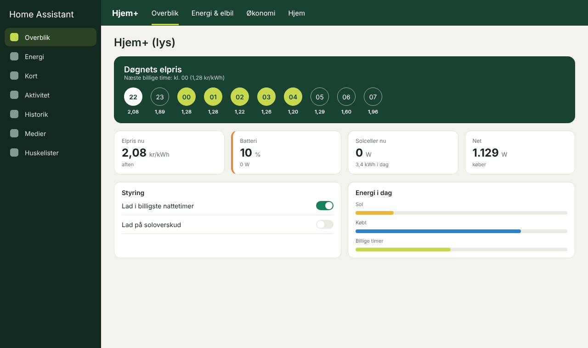
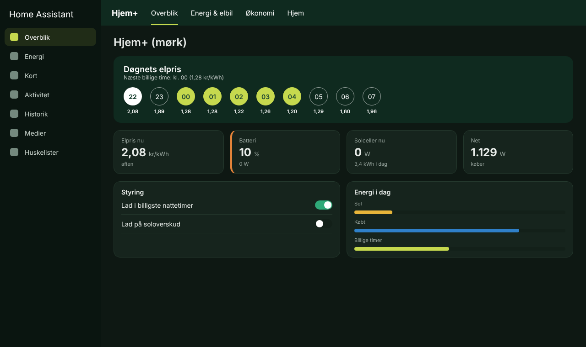
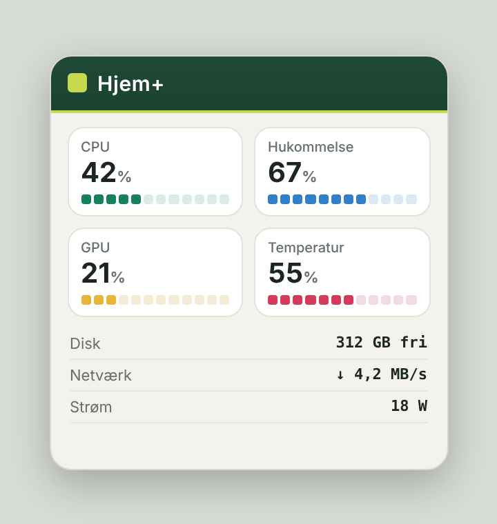
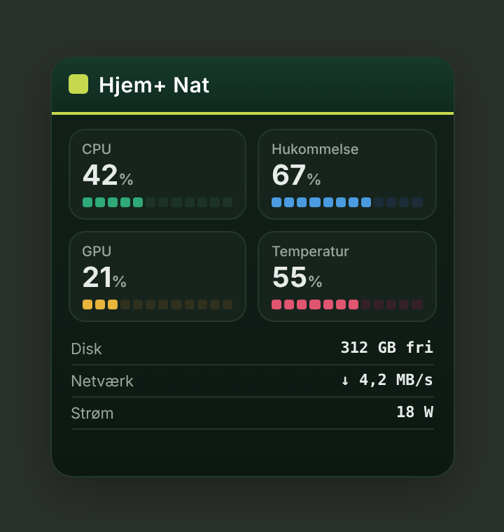

# Hjem+ — Home Assistant theme

🇩🇰 [Dansk](#dansk) · 🇬🇧 [English](#english) · 🖼️ [Skærmbilleder / Screenshots](#skærmbilleder--screenshots)

Skovgrøn top og sidebar, cremefarvet baggrund, hvide kort og limegrønne accenter — i lys og mørk udgave, til **Home Assistant** og til **[TMOG](https://tmog.org/skins.html)**.

Forest-green header and sidebar, cream background, white cards and lime accents — light and dark, for **Home Assistant** and **[TMOG](https://tmog.org/skins.html)**.



| Indhold / Contents | Fil / File |
|---|---|
| Home Assistant-tema (lys + mørk) | [`themes/hjemplus.yaml`](themes/hjemplus.yaml) |
| TMOG-skin, lys | [`tmog/hjemplus.tmogskin`](tmog/hjemplus.tmogskin) |
| TMOG-skin, mørk | [`tmog/hjemplus-nat.tmogskin`](tmog/hjemplus-nat.tmogskin) |

---

## Dansk

Et tema til Home Assistant inspireret af Hjem+-dashboardet: skovgrøn top og sidebar, cremefarvet baggrund, hvide kort med bløde hjørner og limegrønne accenter. Temaet har både lys og mørk tilstand og følger din profilindstilling.

### Installation via HACS

1. HACS → ⋮ → **Brugerdefinerede repositories** → tilføj `https://github.com/jenshinnerup-lab/hjemplus-theme`, kategori **Theme**.
2. Søg efter **Hjem+** og installér.
3. Kør handlingen `frontend.reload_themes` (Udviklerværktøjer → Handlinger).
4. Profil → Tema → vælg **Hjem+**.

### Manuel installation

1. Kopiér `themes/hjemplus.yaml` til `/config/themes/`.
2. Sørg for at `configuration.yaml` indeholder:
   ```yaml
   frontend:
     themes: !include_dir_merge_named themes
   ```
3. Kør `frontend.reload_themes`. Hvis du lige har tilføjet `frontend:`-linjen, skal HA genstartes.
4. Profil → Tema → vælg **Hjem+**.

### Sæt som standard for alle brugere

```yaml
automation:
  - alias: Hjem+ tema ved opstart
    triggers:
      - trigger: homeassistant
        event: start
    actions:
      - action: frontend.set_theme
        data:
          name: Hjem+
```

### Brandfarver i egne kort

Temaet eksponerer CSS-variabler, som du kan bruge i egne kort (fx card-mod eller custom cards):

| Variabel | Farve | Brug |
|---|---|---|
| `--hjem-forest` | `#1a4231` | Top, mørke paneler |
| `--hjem-forest-deep` | `#12291f` | Sidebar |
| `--hjem-green` | `#18805c` | Primær / knapper |
| `--hjem-lime` | `#c6d94e` | "Billig", valgt, aktiv |
| `--hjem-orange` | `#e5843a` | Advarsel |
| `--hjem-red` | `#d63a5a` | Fejl / spidslast |
| `--hjem-blue` | `#2f80c9` | Net / info |
| `--hjem-amber` | `#e8b53a` | Sol |

---

## English

A Home Assistant theme inspired by the Hjem+ dashboard: forest-green header and sidebar, cream background, white rounded cards and lime accents. Includes light and dark modes that follow your profile setting.

### Install via HACS

1. HACS → ⋮ → **Custom repositories** → add `https://github.com/jenshinnerup-lab/hjemplus-theme`, category **Theme**.
2. Search for **Hjem+** and install.
3. Run the `frontend.reload_themes` action (Developer tools → Actions).
4. Profile → Theme → select **Hjem+**.

### Manual install

1. Copy `themes/hjemplus.yaml` to `/config/themes/`.
2. Make sure `configuration.yaml` contains:
   ```yaml
   frontend:
     themes: !include_dir_merge_named themes
   ```
3. Run `frontend.reload_themes`. Restart HA if you just added the `frontend:` line.
4. Profile → Theme → select **Hjem+**.

### Set as default for all users

Use the automation in the Danish section above (`frontend.set_theme` with `name: Hjem+` on Home Assistant start).

### Brand colours in custom cards

The theme exposes the `--hjem-*` CSS variables listed in the table above for use in your own cards.

---

## TMOG-skins / TMOG skins

Samme Hjem+-stil til [TMOG](https://tmog.org/skins.html)-popoutvinduet · The same Hjem+ look for the TMOG popout:

- `tmog/hjemplus.tmogskin` — **Hjem+** (lys / light)
- `tmog/hjemplus-nat.tmogskin` — **Hjem+ Nat** (mørk / dark)

**DA:** Kopiér filerne til TMOG's skins-mappe (macOS: `~/Library/Application Support/TMOG/Skins/`, eller **View ▸ Popout Skin ▸ Open Skins Folder**). Vælg derefter **Reload Skins**, og vælg skinnet i listen.

**EN:** Copy the files into TMOG's skins folder (macOS: `~/Library/Application Support/TMOG/Skins/`, or **View ▸ Popout Skin ▸ Open Skins Folder**). Then choose **Reload Skins** and pick the skin in the list.

---

## Skærmbilleder / Screenshots

> Previews renderet med temaets farver · Previews rendered with the theme's colours.

### Home Assistant

| Lys / Light | Mørk / Dark |
|---|---|
|  |  |

### TMOG

| Hjem+ | Hjem+ Nat |
|---|---|
|  |  |

---

## License

MIT
